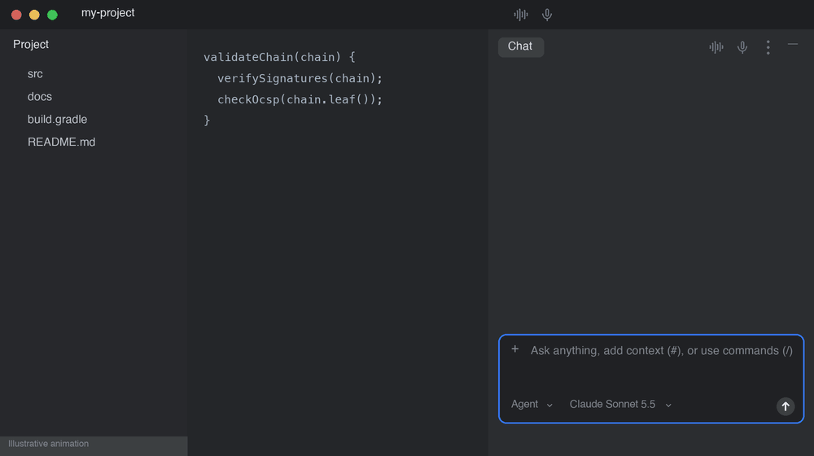

<div align="center">

# 🎙️ Copilot Voice Input

**Talk to GitHub Copilot Chat in IntelliJ IDEA. 100% local, open source.**

[](LICENSE)
[-lightgrey)](#requirements)
[](#requirements)
[](CONTRIBUTING.md)
[](https://github.com/rajumuke-dev/copilot-voice-input)

</div>

Think faster than you type? Click the mic, speak your prompt, and it lands in Copilot Chat.
Transcription runs on [whisper.cpp](https://github.com/ggml-org/whisper.cpp) on your machine, so nothing is sent over
the network except the final text you send to Copilot.

## ✨ Features
- 🎤 **One-click dictation**: mic button in the Copilot Chat title, or ⌘⌥V
- 🚀 **Dictate and send**: ⌘⌥⇧V
- 🙌 **Hands-free mode**: say "turn on the mic", speak, then "done" to send or "cancel" to discard
- 🔒 **Private by design**: local whisper.cpp, no cloud speech service, no transcript logging
- 🎧 **Choose your input**: any microphone, or loopback (e.g. BlackHole) for meeting audio
- 🔇 **Noise handling**: voice-activity detection and optional denoise

<div align="center">



<sub>Illustrative animation of the dictate flow (not a screen recording).</sub>

</div>

## Quick start
1. Install the requirements below (whisper-cpp, a model, microphone permission).
2. `gradle buildPlugin`, then install the zip from disk in IntelliJ and restart.
3. Open Copilot Chat, click the mic (or press ⌘⌥V), speak, and the text appears in the chat input.

## How it works
Microphone → local recording → whisper.cpp (`whisper-cli`) → text inserted into the Copilot Chat input.
No cloud speech service and no transcript logging; audio stays on your machine.

## Requirements
- macOS (Apple Silicon), IntelliJ IDEA 2026.2+ (build 262+) with the GitHub Copilot plugin
- `brew install whisper-cpp` (provides `/opt/homebrew/bin/whisper-cli`)
- A whisper model in `~/.cache/whisper/` (the plugin uses `ggml-small.en.bin`, falling back to `ggml-base.en.bin`):
  ```
  mkdir -p ~/.cache/whisper && cd ~/.cache/whisper
  curl -LO https://huggingface.co/ggerganov/whisper.cpp/resolve/main/ggml-small.en.bin
  ```
- Allow IntelliJ to use the microphone (System Settings → Privacy & Security → Microphone)

## Install
Build the zip (needs IntelliJ IDEA installed at `/Applications/IntelliJ IDEA.app`):
```
gradle buildPlugin
```
Then in IntelliJ: Settings → Plugins → ⚙ → Install Plugin from Disk… → `build/distributions/copilot-voice-input-0.1.0.zip`, and restart.

## Use
- Mic button in the Copilot Chat title: dictate into the chat input. Shortcuts: ⌘⌥V (dictate), ⌘⌥⇧V (dictate and send).
- Hands-free button: say **"turn on the mic"**, speak, then say **"done"** to send, **"cancel"** to discard, or
  **"turn off the mic"** to stop dictating while hands-free keeps listening.
- Tools → "Voice: Select Microphone…" picks another input device. To capture meeting audio, route it through a
  loopback device such as BlackHole.

## Configuration (environment variables)
`COPILOT_VOICE_WHISPER_CLI`, `COPILOT_VOICE_VAD_THRESHOLD` (default 0.015), `COPILOT_VOICE_DENOISE=on`.

## Troubleshooting
- **Nothing is transcribed:** check `whisper-cli` exists (`ls /opt/homebrew/bin/whisper-cli`) or set `COPILOT_VOICE_WHISPER_CLI`, and that a model is in `~/.cache/whisper/`.
- **No audio / silence:** allow IntelliJ in System Settings → Privacy & Security → Microphone, then pick the right device via Tools → "Voice: Select Microphone…".
- **Background noise triggers or misses speech:** adjust `COPILOT_VOICE_VAD_THRESHOLD` or set `COPILOT_VOICE_DENOISE=on`.
- **Mic button missing:** make sure the GitHub Copilot plugin is installed and Copilot Chat is open.

## Development
```
gradle test
```
Source is in `src/main/java/com/rajumuke/voice`.

## Contributing and security
Fork, branch, and open a Pull Request; see [CONTRIBUTING.md](CONTRIBUTING.md). Report vulnerabilities privately per
[SECURITY.md](SECURITY.md). Licensed under [MIT](LICENSE).

## Roadmap
- [x] macOS (Apple Silicon)
- [ ] Windows / Linux
- [ ] Prebuilt release zip (no local build needed)
- [ ] More languages (multilingual models)

Ideas? [Open an issue](https://github.com/rajumuke-dev/copilot-voice-input/issues).

## Known limitations
Tested with synthetic speech and unit tests; behaviour with real microphones and accents may vary.
The mic icon is from [Lucide](https://lucide.dev) (ISC); see `NOTICE.md`.
